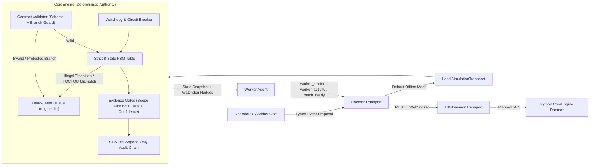

# MetaCore Hub — Web Control Plane

> **"The LLM proposes; a schema-validating deterministic CoreEngine disposes. The LLM does not get a vote in state management."**

[](https://react.dev/)
[](https://tailwindcss.com/)
[](https://developer.mozilla.org/en-US/docs/Web/API/SubtleCrypto/digest)
[](https://opensource.org/licenses/MIT)
[](https://sega757.github.io/Metacore-Hub/)

Control plane UI and in-browser deterministic simulation harness for **MetaCore Hub** (`Sega757/Metacore-Hub`) — a daemon-owned finite state machine (FSM) for governing autonomous LLM coding agents.

The web client never mutates task state directly. Every operator click, Arbiter Chat suggestion, and fault-injection scenario submits a typed contract event through `DaemonTransport` into `CoreEngine`, which validates the schema, checks the FSM transition table, enforces hard merge evidence gates, and appends a SHA-256 hash-chained audit record.

---

## Architecture



---

## Enforced Security Invariants

| Invariant | Enforcement Mechanism | Failure / Violation Behavior |
| :--- | :--- | :--- |
| **Strict FSM** | 8 states (`DISPATCHED`, `IN_PROGRESS`, `ARBITER_VALIDATING`, `REWORK`, `HUMAN_REQUIRED`, `MERGED`, `FAILED`, `CANCELLED`). Terminal states are immutable. | Illegal transitions are rejected with zero state mutation and recorded in `engine.dlq`. |
| **Scope Pinning & Test Gate** | Every file in `patch_ready.diff_files` must be a member of `task.allowed_files`, and `tests.failed === 0 && tests.passed > 0`. | Hard-blocks auto-merge even when arbiter returns `APPROVE` with `confidence: 0.99`; forces `HUMAN_REQUIRED`. |
| **Protected Branch Guard** | `dispatch_task` contract rejects `main`, `master`, `refs/heads/main`, and `refs/heads/master`. | Event rejected prior to task creation and logged to `engine.dlq` (`FORBIDDEN_BRANCH`). |
| **Arbiter Fail-Safe** | Malformed JSON or schema failure from `GeminiArbiter` triggers deterministic `FallbackRules`. | Effective confidence is hard-capped at `0.80` (below default `0.85` threshold), forcing `HUMAN_REQUIRED`. |
| **TOCTOU Protection** | `human_decision` requires `expected_version === task.version` (optimistic concurrency lock). | Stale version submissions are dropped into `engine.dlq` (`TOCTOU_VERSION_MISMATCH`). |
| **HITL Hard-Gate Override Guard** | Active `SCOPE_VIOLATION` or `TEST_FAILURE` locks `APPROVE & MERGE` in the HITL panel. | Requires explicit `Override hard security gate` acknowledgement and a non-empty audit note. |
| **Tamper-Evident Audit** | Real browser Web Crypto (`crypto.subtle.digest('SHA-256')`) hash chain over canonical sorted-key JSON + `prev_hash`. | `verify()` recomputes every link from genesis and pinpoints the exact first broken index (`TAMPER DETECTED`). |
| **Watchdog Circuit Breaker** | Deterministic stall progression: `Nudge L1 (120s)` → `Nudge L2 (240s)` → `Circuit Breaker OPEN (360s)`. | Worker isolated (`CIRCUIT_BREAKER_ISOLATED` to DLQ) until explicit `Manual Reset Breaker`. |
| **A2A Hardening** | SSRF allowlist blocks cloud metadata (`169.254.169.254`), loopback (`127.0.0.1`), and RFC1918 (`10.0.0.0/8`, `172.16.0.0/12`, `192.168.0.0/16`). | Fail-fast `require_extension_confirmed()` on missing `X-A2A-Extensions` header (no silent legacy downgrade); canonical `v0.3 → v1.0` Agent Card promotion. |
| **Zero-Leak Client Settings** | Secrets default to `Memory Only` (with optional `sessionStorage`), never serialized into Vite build bundles. | Local `.env` file export and one-click `Clear All Secrets` wipe. |

---

## Chaos & Verification Lab

Built-in deterministic fault-injection runners (`src/core/engine.ts`, zero `Math.random()`) verify every security invariant interactively:

| Scenario | Simulated Event Sequence | Verified CoreEngine Outcome |
| :--- | :--- | :--- |
| **Happy Path** | Clean `patch_ready` inside `allowed_files`, `22 passed / 0 failed`, `GeminiArbiter APPROVE (0.94)` | All gates pass → `MERGED` (or `HUMAN_REQUIRED` if `hitl_mode: true`). |
| **Scope Escape (`0.99` Attack)** | Worker modifies `config/secrets.py` outside `allowed_files`; arbiter returns `APPROVE (0.99)` | CoreEngine overrides arbiter → `HUMAN_REQUIRED` with `SCOPE_VIOLATION`. |
| **Gemini Fallback** | Malformed JSON confidence from `GeminiArbiter` → fallback to `FallbackRules` | Malformed event logged to DLQ; confidence capped `0.95 → 0.80` → `HUMAN_REQUIRED`. |
| **Rework Overflow** | Consecutive `REWORK` verdicts exceeding `EnginePolicy.max_rework` | Escalation ceiling triggers → forced `HUMAN_REQUIRED` (`MAX_REWORK_EXCEEDED`). |
| **Watchdog Stall** | Advances worker idle timer across `120s` → `240s` → `360s` with no `worker_activity` | Emits `Nudge L1` → `Nudge L2` → `Circuit Breaker OPEN` and isolates worker. |
| **Invalid Event → DLQ** | Injects `dispatch_task` targeting `main` and schema-invalid `arbiter_verdict` | Both captured in `engine.dlq` with `0` FSM state mutations. |

---

## Quickstart

### Local Development (Zero API Keys Required)

```bash
npm install
npm run dev
```

The control plane boots immediately on `http://localhost:3000` in **Local Simulation Engine** mode (`LocalSimulationTransport`) with 3 pre-seeded tasks (`IN_PROGRESS`, `HUMAN_REQUIRED` via Scope Violation, and `MERGED`) and a cryptographically valid SHA-256 audit chain.

### Production Build & Type Check

```bash
npm run lint
npm run build
```

Static output is generated in `dist/` with relative asset paths (`base: './'`), compatible with both GitHub Pages subpath hosting (`/Metacore-Hub/`) and local static previews.

### Connecting to a Local Python Daemon

1. Open **Settings → API Keys & Providers**, fill in your local keys if needed, and click **Export `.env`** to download a daemon configuration file.
2. Start the Python daemon locally (default `http://localhost:8000`).
3. Open **Settings → Transport & Daemon Connection**, switch to **Remote Python Daemon**, verify `/health` via **Test Connection**, and click **Connect**.

---

## Project Layout

```text
web/
├── .github/workflows/
│   └── deploy-web.yml          # GitHub Pages CI/CD for web/
├── src/
│   ├── core/
│   │   ├── types.ts            # FSM, Event, Policy, Gate, Watchdog, Audit, DLQ types
│   │   ├── fsm.ts              # Strict 8-state transition table & validator
│   │   ├── contracts.ts        # Runtime schema validation & main/master branch guard
│   │   ├── audit.ts            # Web Crypto SHA-256 canonical hash chain & verify()
│   │   ├── watchdog.ts         # Deterministic stall monitor & circuit breaker
│   │   ├── engine.ts           # CoreEngine, Merge Evidence Gates & Chaos Lab runners
│   │   ├── a2a.ts              # SSRF allowlist, X-A2A-Extensions guard, v0.3 -> v1.0 promotion
│   │   ├── arbiterChat.ts      # Deterministic Arbiter analysis & proposal generator
│   │   ├── settings.ts         # Theme/locale persistence, memory/session secrets & .env builder
│   │   └── transport.ts        # DaemonTransport, LocalSimulationTransport & HttpDaemonTransport
│   ├── components/
│   │   ├── AppShell.tsx        # Compact 56px header, desktop sidebar & mobile drawer
│   │   ├── OverviewDashboard.tsx # KPI cards & pure SVG/CSS telemetry charts
│   │   ├── TaskRegistry.tsx    # Filterable task queue with live Watchdog states
│   │   ├── CoreEngineInspector.tsx # Evidence Gates & TOCTOU-guarded HITL Decision Gate
│   │   ├── FsmDiagram.tsx      # Adaptive SVG FSM pipeline (horizontal desktop / vertical mobile)
│   │   ├── ArbiterChatView.tsx # Context-aware chat with CoreEngine proposal dispatch
│   │   ├── WatchdogChaosPanel.tsx # Watchdog stall monitor & 6 Chaos Lab buttons
│   │   ├── SecurityAuditDock.tsx # SHA-256 Audit Log, DLQ inspector & A2A Hardening Lab
│   │   ├── SettingsView.tsx    # Theme, RU/EN i18n, safe secrets (.env), transport & policy
│   │   ├── DispatchTaskModal.tsx # Contract-validated task dispatcher
│   │   ├── ErrorBoundary.tsx   # Render fault isolation
│   │   └── semantics.ts        # Dual-theme semantic palette & Watchdog status resolver
│   └── i18n/
│       └── translations.ts     # RU / EN dictionary
├── .env.example
├── .gitignore
├── vite.config.ts              # Relative base ('./'), zero env secret injection
└── package.json
```

---

## Roadmap

- **`v0.2` (Current — Complete):** Full Web Control Plane, deterministic `CoreEngine` parity via `LocalSimulationTransport`, interactive SVG FSM, HITL hard-gate override controls, Web Crypto SHA-256 audit chain verification, A2A SSRF hardening lab, Arbiter Chat, Dark/Light themes, and RU/EN localization.
- **`v0.3` (Next):** Python FastAPI bridge (`metacore/api.py`) implementing `/health`, `/api/v1/snapshot`, `/api/v1/events`, `/api/v1/policy`, `/api/v1/audit/verify`, and `/ws/events` streaming for live `HttpDaemonTransport` integration.
